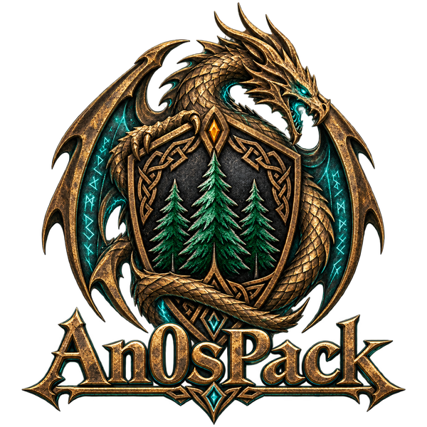
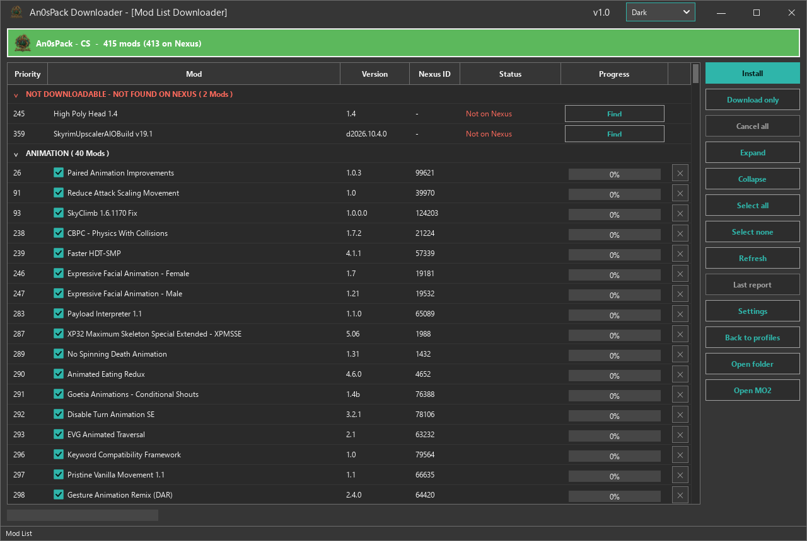
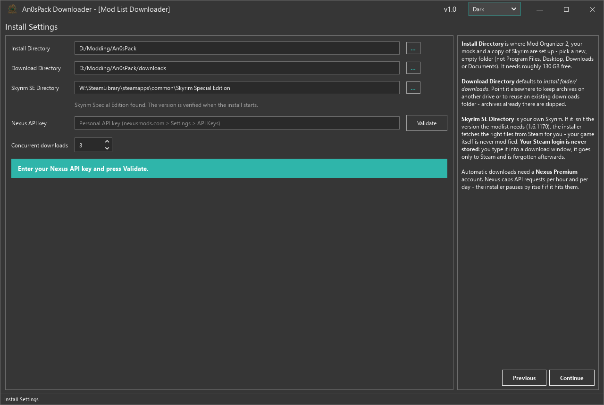
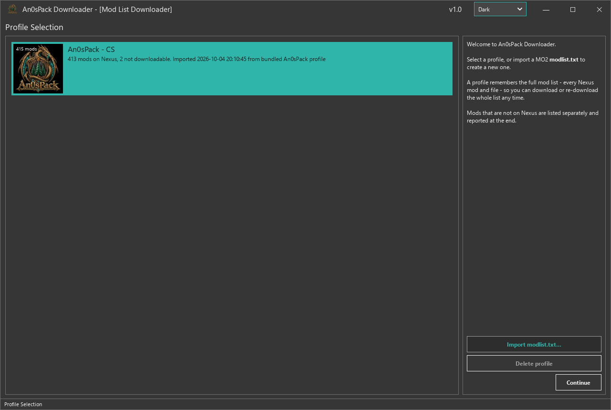
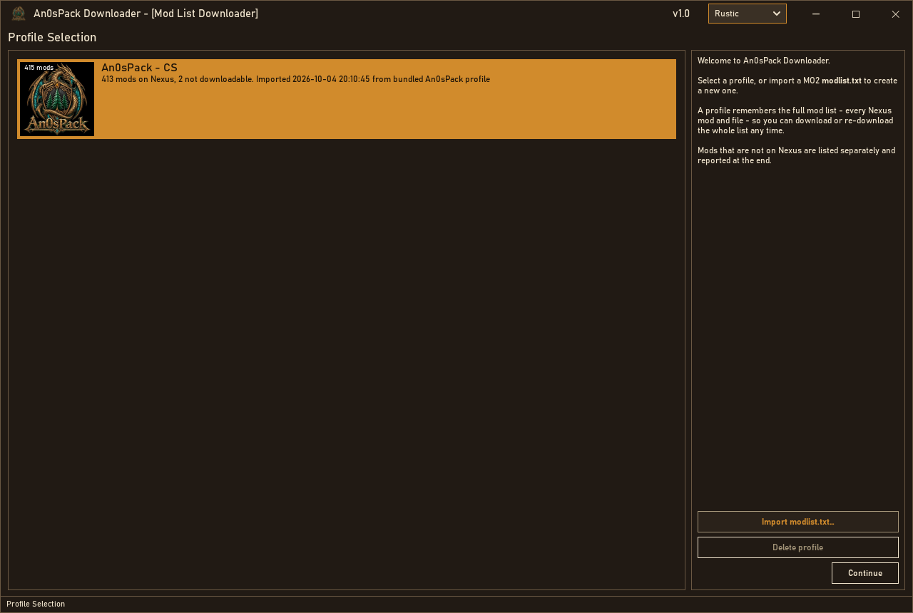
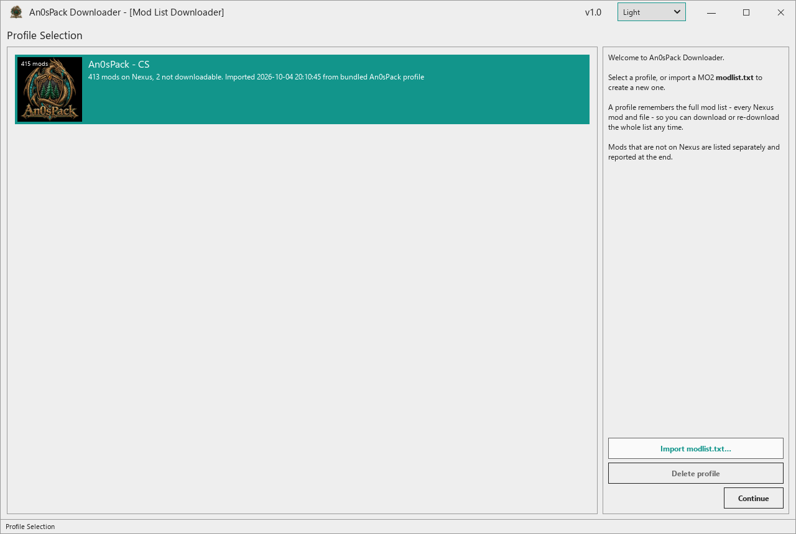

<p align="center">
  
</p>

<h1 align="center">An0sPack Downloader</h1>

<p align="center">
  A dedicated Windows downloader and installer for An0sPack,<br>
  a Skyrim Special Edition modpack built around Community Shaders.
</p>

<p align="center">
  <a href="#about-the-modpack">The modpack</a> ·
  <a href="#featured-mods">Featured mods</a> ·
  <a href="#application-screenshots">Screenshots</a> ·
  <a href="#application-themes">Themes</a> ·
  <a href="#getting-started">Getting started</a> ·
  <a href="https://github.com/An0sTheGreat/An0sPack-Downloader/issues">Report an issue</a>
</p>

## About the modpack

**An0sPack** brings together a forest-rich Skyrim, modern lighting and materials, responsive third-person combat, expanded character builds, and a cohesive interface. Its graphics setup is built around **Community Shaders**, with a curated collection of environment, animation, gameplay, audio, and UI mods.

The included **An0sPack - CS** profile combines familiar community favorites with compatibility patches, generated outputs, and pack-specific settings. Highlights include:

- **Visuals and exploration:** Community Shaders, denser forests, reworked roads, improved landscapes, and generated distant scenery.
- **Combat and movement:** directional movement, a configurable third-person camera, melee collision, timed blocking, and rapid bow combos.
- **Character builds:** expanded perks, spells, and enchantments through Ordinator, Odin, Apocalypse, and Summermyst.
- **World and roleplaying:** additional NPCs and creatures, notice-board quests, more flexible quest pacing, and voiced player dialogue.
- **Interface:** Norden UI, SkyUI, QuickLoot IE, and Wheeler.

See the [bundled profile](data/profiles/An0sPack%20-%20CS.json) for the current mod and archive list. The highlights below are a selection, not the complete list.

## Featured mods

| Area | Included mods | What they add |
| --- | --- | --- |
| Graphics and lighting | [Community Shaders](https://www.nexusmods.com/skyrimspecialedition/mods/86492), [Lux Via](https://www.nexusmods.com/skyrimspecialedition/mods/63588) | The pack's shader framework and roadside lighting and detail. |
| Forests and roads | [Fabled Forests](https://www.nexusmods.com/skyrimspecialedition/mods/94462), [Veydogolt Trees](https://www.nexusmods.com/skyrimspecialedition/mods/62414), [Northern Roads](https://www.nexusmods.com/skyrimspecialedition/mods/77530) | Fuller forests, varied trees, and redesigned roads. |
| Third-person gameplay | [True Directional Movement](https://www.nexusmods.com/skyrimspecialedition/mods/51614), [SmoothCam](https://www.nexusmods.com/skyrimspecialedition/mods/41252) | Directional movement and a customizable third-person camera. |
| Melee combat | [Valhalla Combat](https://www.nexusmods.com/skyrimspecialedition/mods/64741), [Precision](https://www.nexusmods.com/skyrimspecialedition/mods/72347), [BFCO](https://www.nexusmods.com/skyrimspecialedition/mods/117052) | Timed defense, accurate weapon collisions, and a combat animation framework. |
| Archery | [Dynamic Bow Animation](https://www.nexusmods.com/skyrimspecialedition/mods/89048), [Bow Rapid Combo V3](https://www.nexusmods.com/skyrimspecialedition/mods/89308) | New bow animations and rapid-fire combos, with the profile's BFCO compatibility fix. |
| Perks, magic, and loot | [Ordinator](https://www.nexusmods.com/skyrimspecialedition/mods/1137), [Odin](https://www.nexusmods.com/skyrimspecialedition/mods/46000), [Apocalypse](https://www.nexusmods.com/skyrimspecialedition/mods/1090), [Summermyst](https://www.nexusmods.com/skyrimspecialedition/mods/6285) | More build choices, spell variety, and enchantments. |
| World and quests | [Interesting NPCs](https://www.nexusmods.com/skyrimspecialedition/mods/29194), [Skyrim Immersive Creatures](https://www.nexusmods.com/skyrimspecialedition/mods/12680), [Missives](https://www.nexusmods.com/skyrimspecialedition/mods/17576), [At Your Own Pace](https://www.nexusmods.com/skyrimspecialedition/mods/52704) | Additional encounters, characters, local jobs, and quest pacing options. |
| Player voice | [Dragonborn Voice Over](https://www.nexusmods.com/skyrimspecialedition/mods/84329), [Bella Voice](https://www.nexusmods.com/skyrimspecialedition/mods/183536) | Voiced player dialogue with the pack's selected voice and patches. |
| Menus and controls | [Norden UI](https://www.nexusmods.com/skyrimspecialedition/mods/166086), [SkyUI](https://www.nexusmods.com/skyrimspecialedition/mods/12604), [QuickLoot IE](https://www.nexusmods.com/skyrimspecialedition/mods/120075), [Wheeler](https://www.nexusmods.com/skyrimspecialedition/mods/97345) | Restyled menus, inventory tools, quick looting, and a radial equipment menu. |

## What the downloader does

- Downloads the archives needed by the selected profile, with **up to five concurrent downloads**.
- Reuses existing archives and supports interrupted-download recovery.
- Installs the bundled `.an0s` package into a **portable Mod Organizer 2** setup with the pack's file layout and settings.
- Sets up a separate **Game Root**, using your own Skyrim files and the required Steam runtime files.
- Provides per-file progress, cancellation, failure reports, and shortcuts to the install folder and MO2.
- Supports **Download only**, plus importing other MO2 `modlist.txt` files.

The compiled An0sPack package contains the intended installation choices. Imported modlists use a **best-effort installation** and do not automatically reproduce another author's patches or FOMOD selections.

## Application screenshots

### Mod list and download controls



### Installation settings



*Captured from the application's repository source with example installation paths and no account credentials. No download progress or successful installation is simulated.*

## Application themes

Switch themes from the dropdown in the application's title bar. The selection is remembered between sessions. These change the **downloader's appearance**; Skyrim's in-game UI is configured separately.

| Dark | Rustic | Light |
| :---: | :---: | :---: |
| Charcoal with teal accents | Warm brown with amber accents | Light surfaces with teal accents |
| [](assets/screenshots/theme-dark.png) | [](assets/screenshots/theme-rustic.png) | [](assets/screenshots/theme-light.png) |

Click a screenshot to view it at full size. Older builds called Rustic **Fantasy**.

## Requirements

- **Windows**, with a Steam installation of **Skyrim Special Edition** and the Anniversary Edition / Creation Club content used by the bundled profile.
- **Skyrim runtime 1.6.1170** for the bundled setup. If your installed runtime differs, follow the installer's Steam download instructions.
- A **Nexus Mods Premium account** and a personal Nexus API key for automatic Nexus downloads.
- Enough disk space for the installed pack, downloaded archives, and temporary extraction files. The current package is approximately **125 GB installed plus 68 GB of archives**. Budget **at least 220 GB free** if both share one drive; the installer calculates its own space checks.
- **Git LFS** if obtaining the complete repository by cloning it. The executable and `.an0s` package are stored through LFS.

Some archives without an automatic download source may need to be supplied manually, including **High Poly Head**. Follow the installer report and place requested archives in the selected download folder before retrying.

## Getting started

### 1. Get the complete application

With [Git LFS](https://git-lfs.com/) installed:

```sh
git lfs install
git clone https://github.com/An0sTheGreat/An0sPack-Downloader.git
cd An0sPack-Downloader
```

Keep **`An0sPackDownloader.exe`**, **`assets/`**, and **`data/`** together. Check that the executable and `data/profiles/An0sPack - CS.an0s` are real downloaded files, rather than small Git LFS pointer files.

### 2. Choose and configure the profile

1. Run **An0sPackDownloader.exe** and select **An0sPack - CS**.
2. Click **Continue** and choose a new, empty installation folder, such as `D:\Modding\An0sPack`.
3. Choose a download folder, or leave the default `<install folder>\downloads`. An existing archive folder can be reused.
4. Confirm the Skyrim directory, enter your Nexus API key, and click **Validate**.
5. Continue to the mod list and click **Install**. Follow any prompts for Steam runtime files or manually supplied archives.
6. Review the completion report. Open the installed **An0sPack - MO2** shortcut and launch the **An0sPack / SKSE** entry from MO2.

Use **Download only** when you want to collect archives without installing the pack. Choose a location outside protected or synced folders such as Program Files, Documents, Desktop, or OneDrive.

## Help and troubleshooting

| Problem | What to check |
| --- | --- |
| Automatic Nexus downloads are unavailable | Validate the API key and confirm that the account has Premium access. |
| A file is missing or has no automatic source | Read the report, add the requested archive to the download folder, and retry. |
| Installation was interrupted | Reopen the application and use the same profile, install folder, and download folder. |
| Skyrim's runtime does not match | Follow the Steam runtime prompts; the bundled profile targets 1.6.1170. |
| The executable or package is only a tiny text file | Run `git lfs pull` from the repository folder. |
| An imported modlist installs differently | Imported lists use best-effort extraction; only a compiled package records exact installation choices. |

For unresolved problems, [open an issue](https://github.com/An0sTheGreat/An0sPack-Downloader/issues) with the application version, selected profile, error message, and relevant report. Remove account information and API keys before sharing logs or screenshots.

<details>
<summary><strong>Run from source</strong></summary>

On Windows, with Python and the repository's assets and data available:

```sh
py -m pip install PySide6 httpx pefile
py app.py
```

The main modules are `app.py` (interface), `core.py` (profiles and downloads), `installer.py` (installation), `compiler.py` (author-side package creation), and `skse.py` (SKSE staging).

</details>

## Credits

An0sPack is assembled by **[An0sTheGreat](https://github.com/An0sTheGreat)**. The mods, frameworks, tools, and artwork remain the work of their respective creators. Visit the linked mod pages for author credits, permissions, and support.

The downloader uses **PySide6**, **httpx**, **pefile**, **Mod Organizer 2**, and bundled **7-Zip** tools. The bundled 7-Zip license is available in [assets/7z/License.txt](assets/7z/License.txt).
